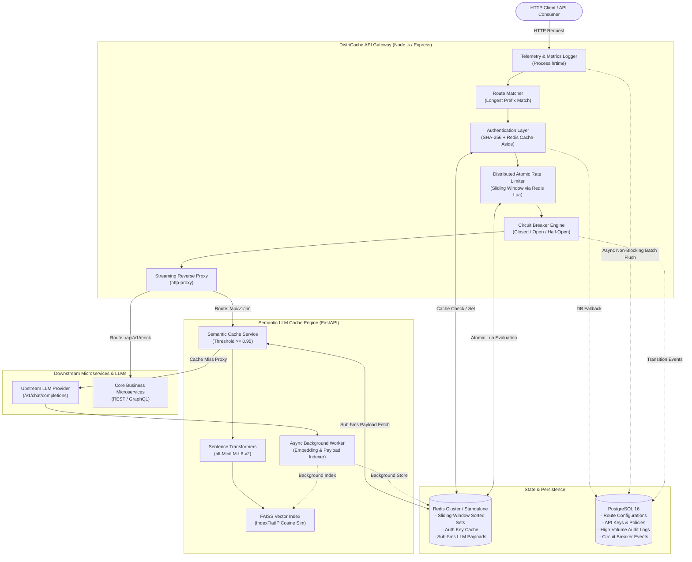

# DistriCache — System Architecture Blueprint

DistriCache is a high-throughput, production-grade distributed infrastructure platform featuring an **API Gateway Reverse Proxy**, a **Redis-backed Atomic Sliding-Window Rate Limiter**, and a **FAISS Vector-based Semantic Cache Engine for LLMs**.

---

## 1. High-Level System Architecture

---

## 2. Core Subsystems

### 2.1 Reverse Proxy & Gateway Routing Layer
- **Dynamic Routing Table**: Routes are dynamically queried from PostgreSQL at boot and kept in an in-memory routing table sorted by prefix length. Updates can be pushed at runtime without restarting gateway instances via the `/admin/routes/reload` webhook.
- **Circuit Breaker State Machine**:
  - Implements a resilient 3-state state machine per route:
    - **CLOSED**: Traffic flows normally. Request failures (5xx status codes, network errors, timeouts) are recorded within a rolling window (`rollingWindowMs = 10000ms`). If failure count reaches `failureThreshold` (default: 5), the circuit trips to **OPEN**.
    - **OPEN**: All traffic to the degraded target is immediately short-circuited with `HTTP 503 Service Unavailable` (`X-Circuit-Breaker: OPEN`), preserving gateway resources and downstream recovery capacity. After `recoveryTimeoutMs` (default: 15000ms), the circuit automatically enters **HALF_OPEN**.
    - **HALF_OPEN**: Allows a single probe request through. If successful, resets failure counters and transitions back to **CLOSED**. If the probe fails, immediately trips back to **OPEN** for another recovery window.
  - State changes are broadcast and persisted to PostgreSQL `circuit_breaker_events` asynchronously.
- **Active Health Checking**: Background daemon continuously queries registered `/health` endpoints of downstream microservices, tracking latency and target health.

### 2.2 Distributed Atomic Sliding-Window Rate Limiter
Standard naive rate limiters (e.g. fixed window counters) suffer from burst boundary issues where twice the limit can be consumed at the window edge. Simple token buckets in distributed architectures suffer from multi-server race conditions unless guarded by locks.

DistriCache solves this by implementing an **Atomic Sliding Window Rate Limiter** executed directly in Redis via an embedded **Lua script**:
1. **Sorted Set Key**: `ratelimit:{client_id}:{route_id}`
2. **Atomic Lua Execution**:
   - `ZREMRANGEBYSCORE key -inf (now - window_ms)`: Purges expired timestamps.
   - `ZCARD key`: Counts requests currently active in the exact sliding window.
   - If count `< max_requests`:
     - `ZADD key now unique_member_id`
     - `PEXPIRE key window_ms`
     - Returns `[1, remaining_tokens, reset_seconds]`
   - If count `>= max_requests`:
     - Reads oldest timestamp to compute exact millisecond wait time:
       $\text{RetryAfter} = \lceil \frac{(\text{oldest\_ts} + \text{window\_ms}) - \text{now}}{1000} \rceil$
     - Returns `[0, 0, retry_after_seconds]`
3. **HTTP RFC Compliance**: Automatically injects standard rate limiting headers:
   - `X-RateLimit-Limit`: Maximum requests permitted per window.
   - `X-RateLimit-Remaining`: Remaining request allowance in current window.
   - `X-RateLimit-Reset`: Seconds remaining until oldest slot expires.
   - `Retry-After`: Seconds client must wait before retrying (on HTTP 429).

### 2.3 Semantic LLM Query Cache Engine (FastAPI + FAISS)
Traditional key-value caches fail for Large Language Models because natural language has infinite variations for identical intent (e.g., *"How do I sort an array in Python?"* vs *"Python array sorting example"*).

DistriCache's Semantic Cache solves this:
1. **Dense Vector Embeddings**: Uses `sentence-transformers/all-MiniLM-L6-v2` to map prompts into a 384-dimensional dense semantic embedding space.
2. **Exact Cosine Similarity via FAISS**:
   - Embeddings are L2-normalized: $\|v\|_2 = 1.0$.
   - The index uses `faiss.IndexFlatIP(384)` (Inner Product).
   - Mathematical property: For unit vectors, $A \cdot B = \cos(\theta)$. Thus, Inner Product is exact Cosine Similarity.
3. **Similarity Threshold**:
   - $\text{Threshold} \ge 0.95$.
   - Any query matching an existing vector with score $\ge 0.95$ triggers a **Cache HIT**.
4. **Sub-5ms Payload Retrieval**:
   - Payloads are stored in Redis (`cache:llm:payload:{entry_id}`) with configurable TTL.
   - FAISS only stores vector coordinates and entry IDs; the bulky JSON response is retrieved in $<3\text{ms}$ from Redis.
5. **Non-Blocking Asynchronous Indexing**:
   - On **Cache MISS**, the request is forwarded to the downstream LLM.
   - The response is returned to the user immediately with `X-Cache: MISS`.
   - FastAPI `BackgroundTasks` encodes and indexes the new vector into FAISS and stores the payload in Redis without adding latency to the client response.

### 2.4 Telemetry & Audit Persistence Layer
- **High-Throughput Non-Blocking Batching**:
  - The Gateway measures end-to-end request latency using `process.hrtime.bigint()` for sub-microsecond precision.
  - Completed request records are placed in a high-speed memory buffer.
  - A background flusher batch-inserts up to 100 entries per transaction every 1 second into PostgreSQL `audit_logs`.
  - Zero latency penalty added to client request paths.
