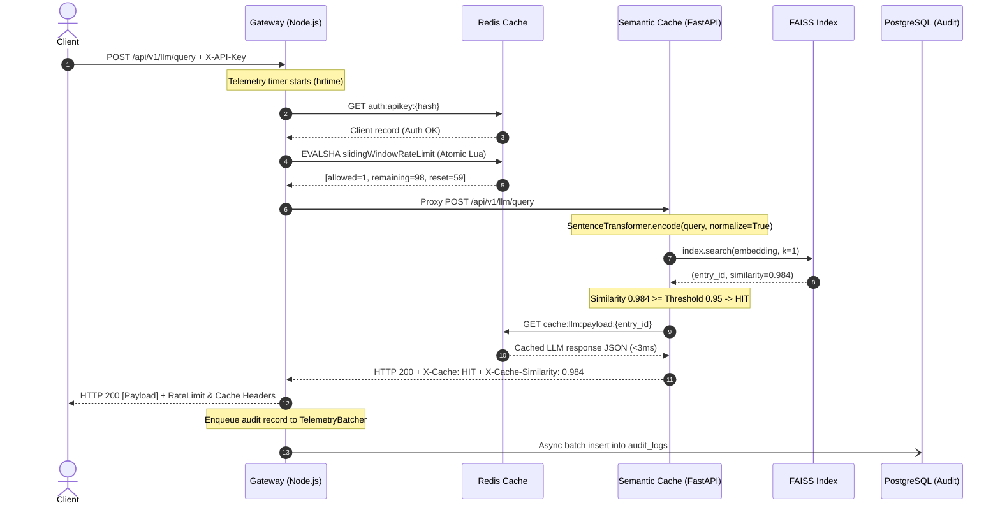
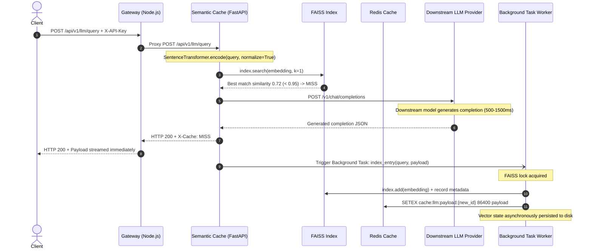
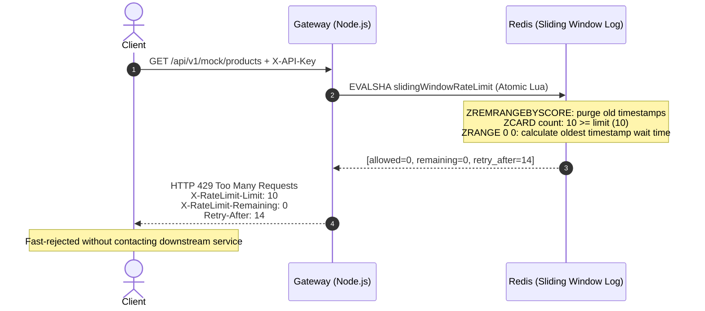
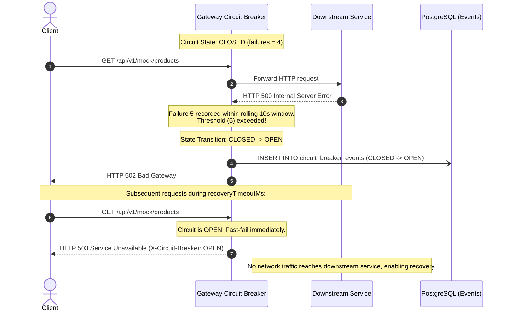
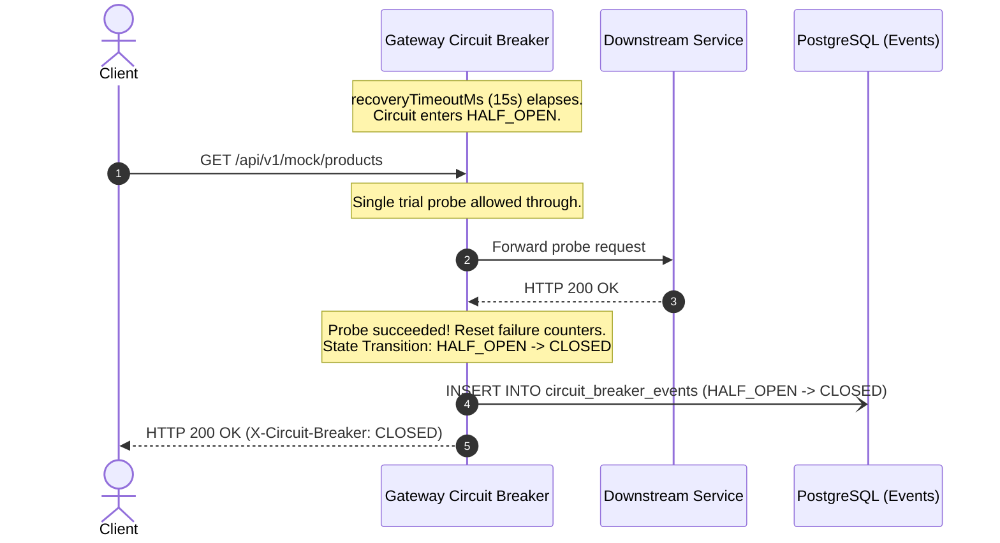

# DistriCache — Detailed Request Flows & Sequence Diagrams

This document details the step-by-step lifecycle of incoming requests across all operational scenarios in the DistriCache architecture.

---

## 1. Scenario A: Semantic Cache HIT (Sub-5ms Response)

When a client sends a prompt that is semantically equivalent ($\ge 0.95$ Cosine Similarity) to a previously answered query:

---

## 2. Scenario B: Semantic Cache MISS & Async Indexing

When a client sends a novel query that does not exist in the FAISS vector index:

---

## 3. Scenario C: Rate Limit Exceeded (HTTP 429 Too Many Requests)

When a client exceeds their tier allowance within the active sliding window:

---

## 4. Scenario D: Downstream Failure & Circuit Breaker Tripping

When a downstream service degrades and consecutive errors exceed the threshold:

---

## 5. Scenario E: Circuit Breaker Recovery (HALF_OPEN -> CLOSED)

After the recovery cooldown expires:

